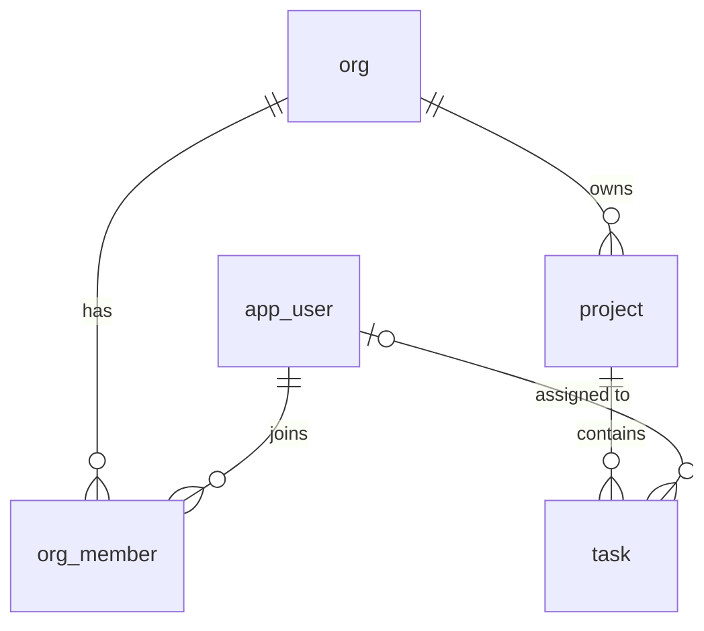

# Schema Templates

Two complete worked examples of the same domain: PostgreSQL 18 and MySQL 8.4 (InnoDB). Adapt names and types to the domain. Both examples comment **every table and every column**; keep that in real output.

- PostgreSQL 17 or earlier: replace `uuidv7()` with `gen_random_uuid()` or an app-generated UUIDv7.
- MySQL: generate UUIDv7 in the app and store `UUID_TO_BIN(uuid, 0)`. There is no built-in `uuidv7()`.
- Neither script declares a foreign key constraint. Reference columns keep the parent's name and type and are indexed; the intended `ON DELETE` behavior lives in `database-design.md` and is enforced by the service.
- `NOT NULL` marks only columns a row cannot exist without, or columns with a `DEFAULT`; every optional field is nullable. Do not copy a strict `NOT NULL` onto every attribute.

## Contents
- Worked example: multi-tenant project tracker (PostgreSQL 18)
- The same example in MySQL 8.4 (InnoDB)
- Row-level security (PostgreSQL)
- Text ERD
- Migration with rollback (PostgreSQL)
- Migration with rollback (MySQL)
- MongoDB collection with validation

## Worked example: multi-tenant project tracker (PostgreSQL 18)

```sql
-- Shared trigger function: keep updated_at current on every UPDATE
CREATE OR REPLACE FUNCTION set_updated_at() RETURNS trigger
LANGUAGE plpgsql AS $$
BEGIN
  NEW.updated_at := now();
  RETURN NEW;
END;
$$;

CREATE TABLE org (
  org_id     uuid PRIMARY KEY DEFAULT uuidv7(),
  name       text NOT NULL CHECK (char_length(name) BETWEEN 1 AND 200),
  slug       text NOT NULL UNIQUE,
  created_at timestamptz NOT NULL DEFAULT now(),
  updated_at timestamptz NOT NULL DEFAULT now()
);
COMMENT ON TABLE org IS '组织/租户';
COMMENT ON COLUMN org.org_id IS '组织主键';
COMMENT ON COLUMN org.name IS '组织名称，1–200 字';
COMMENT ON COLUMN org.slug IS 'URL 短标识，全局唯一';
COMMENT ON COLUMN org.created_at IS '创建时间（UTC）';
COMMENT ON COLUMN org.updated_at IS '最后更新时间（UTC）';

CREATE TABLE app_user (
  app_user_id uuid PRIMARY KEY DEFAULT uuidv7(),
  email       text NOT NULL,
  full_name   text,
  status      smallint NOT NULL DEFAULT 1 CHECK (status IN (0, 1)),
  created_at  timestamptz NOT NULL DEFAULT now(),
  updated_at  timestamptz NOT NULL DEFAULT now()
);
COMMENT ON TABLE app_user IS '平台用户，可加入多个组织';
COMMENT ON COLUMN app_user.app_user_id IS '用户主键';
COMMENT ON COLUMN app_user.email IS '登录邮箱，大小写不敏感唯一';
COMMENT ON COLUMN app_user.full_name IS '展示姓名，可空';
COMMENT ON COLUMN app_user.status IS '状态：0=禁用；1=启用';
COMMENT ON COLUMN app_user.created_at IS '创建时间（UTC）';
COMMENT ON COLUMN app_user.updated_at IS '最后更新时间（UTC）';
-- Case-insensitive uniqueness; also serves lookups by lower(email)
CREATE UNIQUE INDEX app_user_email_lower_key ON app_user (lower(email));

-- No FK constraints: the service deletes member rows when an org or a user is removed
CREATE TABLE org_member (
  org_id      uuid NOT NULL,
  app_user_id uuid NOT NULL,
  role        text NOT NULL DEFAULT 'member' CHECK (role IN ('owner', 'admin', 'member')),
  created_at  timestamptz NOT NULL DEFAULT now(),
  PRIMARY KEY (org_id, app_user_id)
);
COMMENT ON TABLE org_member IS '用户与组织的成员关系，含角色';
COMMENT ON COLUMN org_member.org_id IS '所属组织';
COMMENT ON COLUMN org_member.app_user_id IS '成员用户';
COMMENT ON COLUMN org_member.role IS '组织内角色：owner/admin/member';
COMMENT ON COLUMN org_member.created_at IS '加入时间（UTC）';
-- The PK serves "members of an org"; this serves "orgs for a user"
CREATE INDEX idx_org_member_user ON org_member (app_user_id);

CREATE TABLE project (
  project_id uuid PRIMARY KEY DEFAULT uuidv7(),
  org_id     uuid NOT NULL,  -- indexed by UNIQUE (org_id, name)
  name       text NOT NULL,
  created_at timestamptz NOT NULL DEFAULT now(),
  updated_at timestamptz NOT NULL DEFAULT now(),
  UNIQUE (org_id, name)
);
COMMENT ON TABLE project IS '组织下的项目';
COMMENT ON COLUMN project.project_id IS '项目主键';
COMMENT ON COLUMN project.org_id IS '所属组织';
COMMENT ON COLUMN project.name IS '项目名，组织内唯一';
COMMENT ON COLUMN project.created_at IS '创建时间（UTC）';
COMMENT ON COLUMN project.updated_at IS '最后更新时间（UTC）';

CREATE TABLE task (
  task_id              uuid PRIMARY KEY DEFAULT uuidv7(),
  org_id               uuid NOT NULL,
  project_id           uuid NOT NULL,
  assignee_app_user_id uuid,
  title                text NOT NULL CHECK (char_length(title) BETWEEN 1 AND 500),
  status               smallint NOT NULL DEFAULT 0 CHECK (status IN (0, 1, 2)),
  due_at               timestamptz,
  created_at           timestamptz NOT NULL DEFAULT now(),
  updated_at           timestamptz NOT NULL DEFAULT now()
);
COMMENT ON TABLE task IS '项目内的任务';
COMMENT ON COLUMN task.task_id IS '任务主键';
COMMENT ON COLUMN task.org_id IS '所属组织，与 project_id 保持一致';
COMMENT ON COLUMN task.project_id IS '所属项目';
COMMENT ON COLUMN task.assignee_app_user_id IS '负责人，可为空';
COMMENT ON COLUMN task.title IS '任务标题，1–500 字';
COMMENT ON COLUMN task.status IS '状态：0=待办；1=进行中；2=已完成';
COMMENT ON COLUMN task.due_at IS '截止时间（UTC），可为空';
COMMENT ON COLUMN task.created_at IS '创建时间（UTC）';
COMMENT ON COLUMN task.updated_at IS '最后更新时间（UTC）';
-- Main screen: open tasks for a project by due date
CREATE INDEX idx_task_project_due_open ON task (project_id, due_at) WHERE status <> 2;
-- "My tasks" view; also what the service uses to null out a deleted user's tasks
CREATE INDEX idx_task_assignee ON task (assignee_app_user_id) WHERE assignee_app_user_id IS NOT NULL;
-- RLS policies filter by org
CREATE INDEX idx_task_org ON task (org_id);

CREATE TRIGGER org_updated_at      BEFORE UPDATE ON org      FOR EACH ROW EXECUTE FUNCTION set_updated_at();
CREATE TRIGGER app_user_updated_at BEFORE UPDATE ON app_user FOR EACH ROW EXECUTE FUNCTION set_updated_at();
CREATE TRIGGER project_updated_at  BEFORE UPDATE ON project  FOR EACH ROW EXECUTE FUNCTION set_updated_at();
CREATE TRIGGER task_updated_at     BEFORE UPDATE ON task     FOR EACH ROW EXECUTE FUNCTION set_updated_at();
```

Query-to-index map for this schema:

| Query | Served by |
|---|---|
| Open tasks for a project by due date | `idx_task_project_due_open` (partial) |
| Tasks assigned to me | `idx_task_assignee` |
| Members of an org | `org_member` primary key `(org_id, app_user_id)` |
| Orgs a user belongs to | `idx_org_member_user` |
| Look up user by email | `app_user_email_lower_key` (query with `lower(email) = lower($1)`) |
| Project by name within an org | `UNIQUE (org_id, name)` |


## The same example in MySQL 8.4 (InnoDB)

UUIDv7 values are supplied by the app and stored as `BINARY(16)` with `UUID_TO_BIN(uuid, 0)`. `updated_at` uses `ON UPDATE CURRENT_TIMESTAMP` instead of a trigger. There are no partial indexes: open-task sorting uses a stored generated column.

```sql
CREATE TABLE org (
  org_id     BINARY(16) NOT NULL COMMENT '组织主键，应用生成的 UUIDv7',
  name       VARCHAR(200) NOT NULL COMMENT '组织名称，1–200 字',
  slug       VARCHAR(100) NOT NULL COMMENT 'URL 短标识，全局唯一',
  created_at TIMESTAMP NOT NULL DEFAULT CURRENT_TIMESTAMP COMMENT '创建时间（UTC）',
  updated_at TIMESTAMP NOT NULL DEFAULT CURRENT_TIMESTAMP ON UPDATE CURRENT_TIMESTAMP COMMENT '最后更新时间（UTC）',
  PRIMARY KEY (org_id),
  UNIQUE KEY org_slug_key (slug),
  CONSTRAINT org_name_len CHECK (CHAR_LENGTH(name) BETWEEN 1 AND 200)
) ENGINE=InnoDB DEFAULT CHARSET=utf8mb4 COLLATE=utf8mb4_0900_ai_ci
  COMMENT='组织/租户';

CREATE TABLE app_user (
  app_user_id BINARY(16) NOT NULL COMMENT '用户主键，应用生成的 UUIDv7',
  email       VARCHAR(255) NOT NULL COMMENT '登录邮箱，大小写不敏感唯一',
  full_name   VARCHAR(200) NULL COMMENT '展示姓名，可空',
  status      TINYINT UNSIGNED NOT NULL DEFAULT 1 COMMENT '状态：0=禁用；1=启用',
  created_at  TIMESTAMP NOT NULL DEFAULT CURRENT_TIMESTAMP COMMENT '创建时间（UTC）',
  updated_at  TIMESTAMP NOT NULL DEFAULT CURRENT_TIMESTAMP ON UPDATE CURRENT_TIMESTAMP COMMENT '最后更新时间（UTC）',
  PRIMARY KEY (app_user_id),
  UNIQUE KEY app_user_email_key (email),
  CONSTRAINT app_user_status_check CHECK (status IN (0, 1))
) ENGINE=InnoDB DEFAULT CHARSET=utf8mb4 COLLATE=utf8mb4_0900_ai_ci
  COMMENT='平台用户，可加入多个组织';
-- UNIQUE (email) is case-insensitive under utf8mb4_0900_ai_ci

CREATE TABLE org_member (
  org_id      BINARY(16) NOT NULL COMMENT '所属组织',
  app_user_id BINARY(16) NOT NULL COMMENT '成员用户',
  role        VARCHAR(20) NOT NULL DEFAULT 'member' COMMENT '组织内角色：owner/admin/member',
  created_at  TIMESTAMP NOT NULL DEFAULT CURRENT_TIMESTAMP COMMENT '加入时间（UTC）',
  PRIMARY KEY (org_id, app_user_id),
  KEY idx_org_member_user (app_user_id),
  CONSTRAINT org_member_role_check CHECK (role IN ('owner', 'admin', 'member'))
) ENGINE=InnoDB DEFAULT CHARSET=utf8mb4 COLLATE=utf8mb4_0900_ai_ci
  COMMENT='用户与组织的成员关系，含角色';
-- PK (org_id, app_user_id) already indexes the org_id reference; idx_org_member_user serves "orgs for a user"

CREATE TABLE project (
  project_id BINARY(16) NOT NULL COMMENT '项目主键，应用生成的 UUIDv7',
  org_id     BINARY(16) NOT NULL COMMENT '所属组织',
  name       VARCHAR(200) NOT NULL COMMENT '项目名，组织内唯一',
  created_at TIMESTAMP NOT NULL DEFAULT CURRENT_TIMESTAMP COMMENT '创建时间（UTC）',
  updated_at TIMESTAMP NOT NULL DEFAULT CURRENT_TIMESTAMP ON UPDATE CURRENT_TIMESTAMP COMMENT '最后更新时间（UTC）',
  PRIMARY KEY (project_id),
  UNIQUE KEY project_org_name_key (org_id, name)
) ENGINE=InnoDB DEFAULT CHARSET=utf8mb4 COLLATE=utf8mb4_0900_ai_ci
  COMMENT='组织下的项目';

CREATE TABLE task (
  task_id              BINARY(16) NOT NULL COMMENT '任务主键，应用生成的 UUIDv7',
  org_id               BINARY(16) NOT NULL COMMENT '所属组织，与 project_id 保持一致',
  project_id           BINARY(16) NOT NULL COMMENT '所属项目',
  assignee_app_user_id BINARY(16) NULL COMMENT '负责人，可为空',
  title                VARCHAR(500) NOT NULL COMMENT '任务标题，1–500 字',
  status               TINYINT UNSIGNED NOT NULL DEFAULT 0 COMMENT '状态：0=待办；1=进行中；2=已完成',
  due_at               TIMESTAMP NULL COMMENT '截止时间（UTC），可为空',
  created_at           TIMESTAMP NOT NULL DEFAULT CURRENT_TIMESTAMP COMMENT '创建时间（UTC）',
  updated_at           TIMESTAMP NOT NULL DEFAULT CURRENT_TIMESTAMP ON UPDATE CURRENT_TIMESTAMP COMMENT '最后更新时间（UTC）',
  -- NULL when done. Query: WHERE project_id = ? AND due_sort_key IS NOT NULL ORDER BY due_sort_key
  -- InnoDB still indexes the NULL rows; status <> 2 ORDER BY due_at does not use this index
  due_sort_key TIMESTAMP GENERATED ALWAYS AS (IF(status = 2, NULL, due_at)) STORED COMMENT '未完成任务的截止时间，用于部分索引替代',
  PRIMARY KEY (task_id),
  KEY idx_task_project_due_open (project_id, due_sort_key),
  KEY idx_task_assignee (assignee_app_user_id),
  KEY idx_task_org (org_id),
  CONSTRAINT task_title_len CHECK (CHAR_LENGTH(title) BETWEEN 1 AND 500),
  CONSTRAINT task_status_check CHECK (status IN (0, 1, 2))
) ENGINE=InnoDB DEFAULT CHARSET=utf8mb4 COLLATE=utf8mb4_0900_ai_ci
  COMMENT='项目内的任务';
```

Query-to-index map for this schema:

| Query | Served by |
|---|---|
| Open tasks for a project by due date | `idx_task_project_due_open` on `(project_id, due_sort_key)`, only when the query is `WHERE project_id = ? AND due_sort_key IS NOT NULL ORDER BY due_sort_key`. `WHERE status <> 2 ORDER BY due_at` does not use this index for the filter or the sort. InnoDB still stores the `NULL` entries. |
| Tasks assigned to me | `idx_task_assignee` (also used when the service nulls out a deleted user's tasks) |
| Members of an org | `org_member` primary key `(org_id, app_user_id)` |
| Orgs a user belongs to | `idx_org_member_user` |
| Look up user by email | `app_user_email_key` (case-insensitive under `utf8mb4_0900_ai_ci`) |
| Project by name within an org | `project_org_name_key` |

MySQL has no row-level security. Enforce `org_id` membership in the application, or with views that filter on a session variable. Index `org_id` as above so those checks stay cheap.

Engine differences in this pair of scripts:

- Open-task lookup: PostgreSQL filters `status <> 2` on a partial index. MySQL must filter and sort `due_sort_key`. The done rows remain in the MySQL index.
- Status codes: both engines store `status` as an integer with the map in the comment and a `CHECK` on the domain (PostgreSQL `smallint`, MySQL `TINYINT UNSIGNED`). `0=待办`, `1=进行中`, `2=已完成`.
- Foreign keys: neither script declares one. `org_member.org_id`, `org_member.app_user_id`, `project.org_id`, `task.project_id`, and `task.assignee_app_user_id` are plain reference columns, each indexed as above; the service deletes or nulls the children.
- Email uniqueness: PostgreSQL `lower(email)` folds case and keeps accents distinct. MySQL `utf8mb4_0900_ai_ci` folds case and accents, so `jose` and `josé` cannot both exist.
- Primary keys: PostgreSQL 18 `uuidv7()` versus app-generated UUIDv7 stored with `UUID_TO_BIN(uuid, 0)`. On PostgreSQL 17 or earlier, do not copy the `uuidv7()` default from this example.

## Row-level security (PostgreSQL)

Needed whenever clients reach the database directly (always on Supabase).

```sql
ALTER TABLE task ENABLE ROW LEVEL SECURITY;

-- Members of the task's org can read and write its tasks.
-- current_setting('app.user_id') is set per request by the app; on Supabase use (select auth.uid()).
CREATE POLICY task_member_access ON task
  FOR ALL
  USING (EXISTS (
    SELECT 1 FROM org_member m
    WHERE m.org_id = task.org_id
      AND m.app_user_id = (select current_setting('app.user_id', true)::uuid)
  ))
  WITH CHECK (EXISTS (
    SELECT 1 FROM org_member m
    WHERE m.org_id = task.org_id
      AND m.app_user_id = (select current_setting('app.user_id', true)::uuid)
  ));
```

Repeat for each tenant-scoped table. Policies that only allow reads need just `USING`; split `FOR ALL` into per-operation policies when roles differ (for example only `owner`/`admin` may delete).

## Text ERD

```
org      ──1:N──  project   ──1:N──  task
org      ──N:M──  app_user  (via org_member, with role)
app_user ──1:N──  task      (assignee, optional)
```

Or as Mermaid, which renders on GitHub:



These lines are logical references. No FK constraint backs them in the scripts, so the service keeps them valid and applies the delete behavior.

## Migration with rollback (PostgreSQL)

Keep each migration small, and put `CONCURRENTLY` index builds in their own migration because they cannot run inside a transaction.

```sql
-- migrations/0007_add_task_priority.up.sql
BEGIN;
SET LOCAL lock_timeout = '5s';
ALTER TABLE task
  ADD COLUMN priority smallint NOT NULL DEFAULT 2 CHECK (priority BETWEEN 1 AND 4);
COMMIT;

-- migrations/0008_index_task_priority.up.sql  (no transaction)
CREATE INDEX CONCURRENTLY idx_task_project_priority_open
  ON task (project_id, priority) WHERE status <> 2;
```

```sql
-- migrations/0008_index_task_priority.down.sql  (no transaction)
DROP INDEX CONCURRENTLY IF EXISTS idx_task_project_priority_open;

-- migrations/0007_add_task_priority.down.sql
-- Destructive: drops priority values. Back up first if they matter.
BEGIN;
SET LOCAL lock_timeout = '5s';
ALTER TABLE task DROP COLUMN IF EXISTS priority;
COMMIT;
```

If a `CREATE INDEX CONCURRENTLY` fails partway, it leaves an `INVALID` index; drop it and retry.


## Migration with rollback (MySQL)

Keep each migration small. Prefer `ALGORITHM=INSTANT` or `ALGORITHM=INPLACE, LOCK=NONE`. There is no `CREATE INDEX CONCURRENTLY`.

```sql
-- migrations/0007_add_task_priority.up.sql
SET lock_wait_timeout = 5;
ALTER TABLE task
  ADD COLUMN priority SMALLINT NOT NULL DEFAULT 2,
  ALGORITHM=INSTANT;

ALTER TABLE task
  ADD CONSTRAINT task_priority_check CHECK (priority BETWEEN 1 AND 4),
  ALGORITHM=INPLACE, LOCK=NONE;

-- migrations/0008_index_task_priority.up.sql
ALTER TABLE task
  ADD INDEX idx_task_project_priority_open (project_id, priority),
  ALGORITHM=INPLACE, LOCK=NONE;
```

```sql
-- migrations/0008_index_task_priority.down.sql
ALTER TABLE task
  DROP INDEX idx_task_project_priority_open,
  ALGORITHM=INPLACE, LOCK=NONE;

-- migrations/0007_add_task_priority.down.sql
-- Destructive: drops priority values. Back up first if they matter.
SET lock_wait_timeout = 5;
ALTER TABLE task
  DROP CONSTRAINT task_priority_check,
  ALGORITHM=INPLACE, LOCK=NONE;

ALTER TABLE task
  DROP COLUMN priority,
  ALGORITHM=INPLACE, LOCK=NONE;
```

If InnoDB refuses `INSTANT` or `INPLACE, LOCK=NONE` on a large table, stop and use gh-ost or pt-online-schema-change; do not silently run a table-copy `ALGORITHM=COPY`.

## MongoDB collection with validation

Design from access patterns: embed data read together and bounded in size, reference data that is shared or grows without limit.

```javascript
db.createCollection("task", {
  validator: {
    $jsonSchema: {
      bsonType: "object",
      description: "任务集合：一条文档即一个任务",
      required: ["orgId", "projectId", "title", "status", "createdAt"],
      properties: {
        orgId:     { bsonType: "objectId", description: "所属组织 ID" },
        projectId: { bsonType: "objectId", description: "所属项目 ID" },
        title:     { bsonType: "string", minLength: 1, maxLength: 500, description: "任务标题，1–500 字" },
        status:    { bsonType: "int", enum: [0, 1, 2], description: "状态：0=待办；1=进行中；2=已完成" },
        assignee:  {  // embedded snapshot for list views; source of truth is app_user
          bsonType: "object",
          description: "负责人快照，列表页直接展示；权威数据在 app_user",
          properties: {
            userId: { bsonType: "objectId", description: "负责人用户 ID" },
            name:   { bsonType: "string", description: "负责人姓名快照" }
          }
        },
        dueAt:     { bsonType: "date", description: "截止时间（UTC），可为空" },
        createdAt: { bsonType: "date", description: "创建时间（UTC）" }
      }
    }
  }
});

// Equality, then sort, then range (the ESR rule)
db.task.createIndex({ projectId: 1, status: 1, dueAt: 1 });
db.task.createIndex({ "assignee.userId": 1, dueAt: 1 });
```
